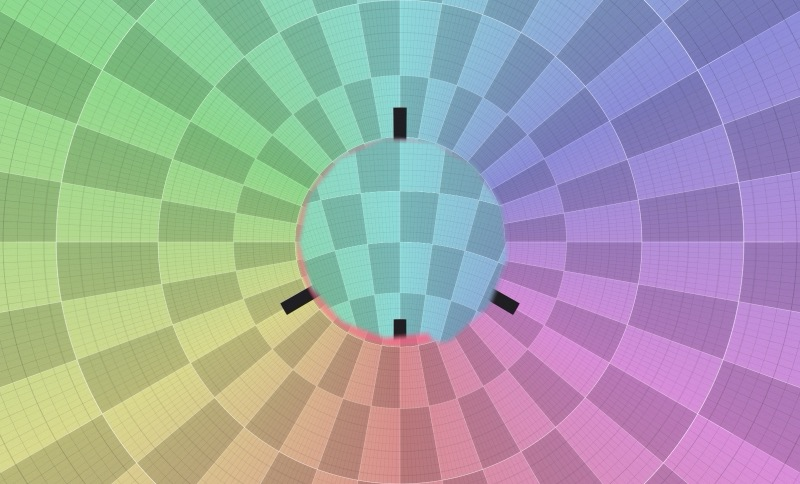
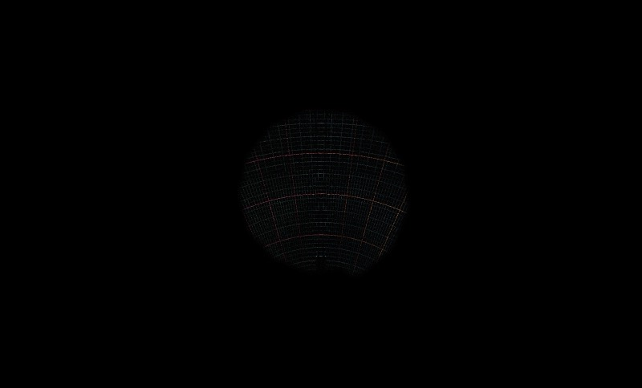
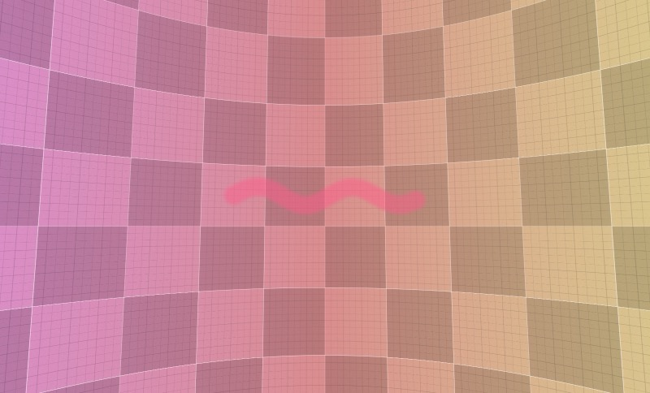
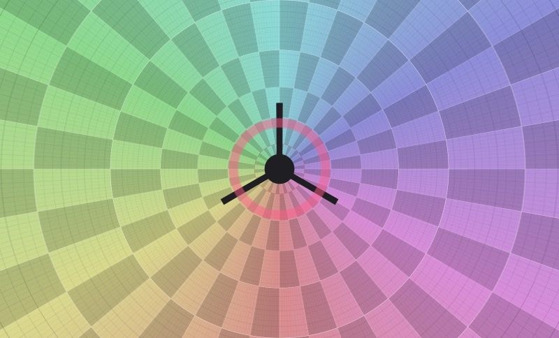
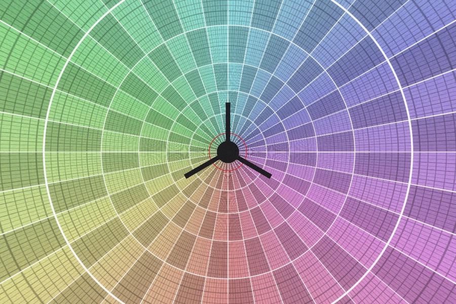
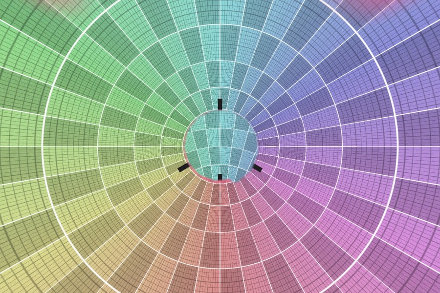
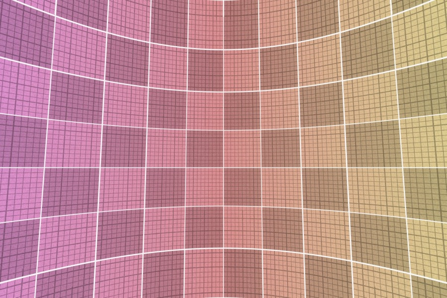
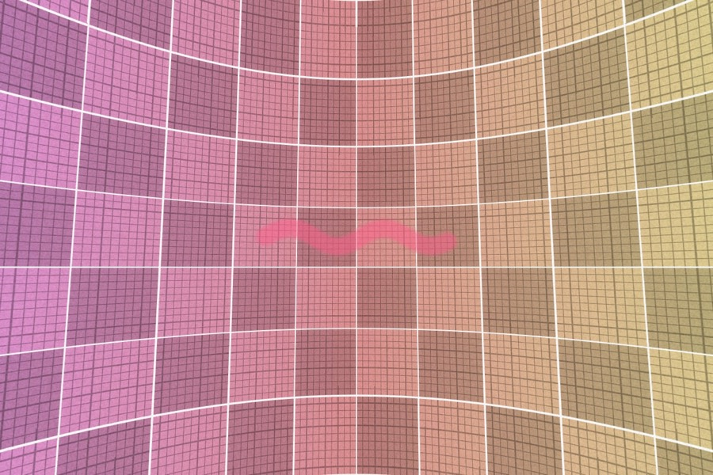
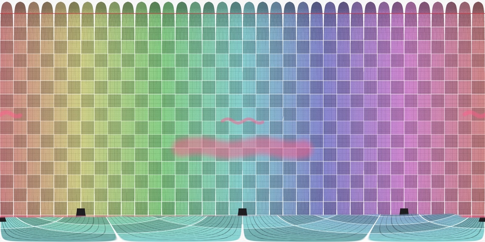

# Spike S2 – Brush round trip: GPU preview + full-resolution commit

- Issue: [#2](https://github.com/777555777/pano-retouch/issues/2)
- Code: branch `spike/s2-brush` (builds on S1/S1b), folder
  [`spikes/s1-tile-viewer/`](https://github.com/777555777/pano-retouch/tree/spike/s2-brush/spikes/s1-tile-viewer) –
  throw-away, not merged into the product
- Date: 2026-10-25
- Status: **macOS measured; Windows run and the maintainer's screen-recording sign-off outstanding**

## Question

How does a stroke feel when the frontend renders an **instant GPU preview** and the Rust core
rasterises it **asynchronously at full resolution** (300 MP)? Is there visible offset, flicker or lag
when the committed result replaces the preview?

## Short answer

**It works and the hand-over is invisible.** On a MacBook Pro M4 Max with 283–288 MP panoramas:

| Criterion (issue #2) | Target | Measured |
| --- | --- | --- |
| Preview while painting | < 16 ms per frame | 60 fps, JS ≈ 1 ms per frame, GPU p95 ≤ 1.6 ms |
| Full-res commit of a typical stroke | < 300 ms, UI never blocks | **40–60 ms** in Rust (r ≤ 2°, 30° long), result on screen after **60–90 ms**; large strokes 0.3 s, a 32 MP scribble 1.1 s – always asynchronous, the UI keeps running at 60 fps |
| No offset/flicker preview → result | maintainer sign-off | pixel diff of the frame before/after the hand-over: **masks ≤ 5/255**, clone ≤ 17/255 on real photos (≤ 25 pixels above 8/255); no offset – see below. Screen recording by the maintainer still to do |
| Seam and both poles correct | golden image test | unit tests (brute-force reference, seam, nadir, wrapping gutters) + golden images below |

## How it works

```
pointer → direction on the sphere ──► stroke (yaw/pitch points + angular radius, ADR-0002)
            │                                       │
            ▼                                       ▼ on release
   GPU preview (viewer.wgsl):              Rust commit (edit.rs):
   per pixel: angular distance to the      per pixel of the affected tiles: the same distance,
   great-circle segments → profile →       profile, tint / clone (Catmull-Rom) at level 0,
   tint / clone sample at R·d              then levels 1…n and the base texture, dirty tiles
            │                                       │
            └──── shown while tile version < stroke version ◄── refreshed tiles carry the new version
```

- **One formula on both sides.** A stroke is a polyline of directions; a pixel's brush value depends on
  its angular distance to the great-circle segments (smoothstep falloff from `radius·hardness` to
  `radius`). Because everything is in directions, the brush is a true circle at the nadir, and the seam
  needs no special case. The shader and `edit.rs` implement exactly the same function.
- **Clone stamp** = a rotation `R` (quaternion): source direction = `R · target direction`. Alt-click sets
  the source, the first stroke fixes `R` ("aligned" mode).
- **Hand-over without flicker:** every committed stroke gets an *edit version*. Every tile slot on the
  GPU knows which version it contains. The shader draws a stroke's preview only where the data shown
  is older than the stroke. After a commit, visible changed tiles are re-requested and written **into
  the same slot** (no fade, no intermediate state); tiles out of view are dropped. Each pixel therefore
  switches from "old data + preview" to "new data" in the very frame its tile arrives.
- **Dirty tracking:** Rust returns exactly the tiles whose slot (tile + 1 px gutter, wrapping at the
  seam, including the partial last column) overlaps changed pixels, per level.

## Results (macOS, M4 Max, canvas 1600×968)

Strokes are scripted (same in the app and in `s1-bench --strokes`): drawn over ~1 s, then committed.
"Visible" = pointer released → last visible tile replaced.

### Commit times

| Stroke | Changed pixels | Rust total | Visible after |
| --- | --- | --- | --- |
| mask r 1.5°, 30° long, horizon | 0.46 MP | 42–58 ms | 62–92 ms |
| mask r 2° across the seam | 0.62 MP | 45–52 ms | 70–76 ms |
| mask ring r 2° around the nadir (−72°) | 6.3 MP | 275–286 ms | 308–310 ms |
| clone r 4°, spiral over the tripod at the nadir | 31.9 MP | 1.11–1.15 s | 1.14–1.17 s |
| clone r 0.15° at 1:1 | 0.01 MP | 22–28 ms | 43–60 ms |
| mask r 10°, 90° long | 9.4 MP | 320–332 ms | 339–357 ms |

Same numbers for the JPEG, the 16-bit TIFF, the half-float EXR and the synthetic panorama – the cost
depends on the changed area, not on the format. Pyramid update ≤ 55 ms, base texture 3–6 ms; the rest is
rasterisation (~30 MP/s with 16 threads in f64). Peak memory 2.5 GB (8-bit) … 4.8 GB (16-bit, EXR).

### Preview vs. committed result

Pixel difference of the frame just before the commit (preview) and the first frame after the hand-over,
only inside the stroke (0–255 per channel):

| Stroke | Synthetic (worst case: 1 px grid lines, pixel noise) | Real photos (JPEG / 16-bit TIFF / EXR) |
| --- | --- | --- |
| masks (4 strokes) | max 1–2 | max 1–5, mean ≤ 0.6 |
| clone spiral at the nadir | max 40, 1970 px > 8 | max 11–17, ≤ 5 px > 8 |
| clone at 1:1 | max 34, 262 px > 8 | max 6–16, ≤ 25 px > 8 |

Remaining differences exist only for the clone stamp, only on very fine high-contrast detail: the
preview takes the source from the level on screen, the commit from full resolution (then averaged
down). Positions and edges match. Images (synthetic, ×8 amplified differences):

| Preview | Difference × 8 |
| --- | --- |
|  |  |
|  |  |
|  |  |

### Golden images (synthetic panorama, rasterised by `edit.rs` at full resolution)

| | before | after all six strokes |
| --- | --- | --- |
| nadir (FOV 110°) |  |  |
| seam (yaw 180°) |  |  |

Equirect after the strokes – the round nadir clone is the whole bottom band, the seam stroke appears on
both edges: 

Unit tests (`cargo test`): distance vs. brute force (dense slerp sampling), seam continuity and dirty
tiles on both sides, a stroke through the nadir covers the whole bottom row, the brush is a circle at
the pole, wrapping gutters of the partial last column, clone reads from the rotated source, propagation
reaches every level, odd-sized levels stay aligned.

## Things learned the hard way

1. **Odd image sizes misaligned the pyramid (bug from S1).** Halving 11 899 rows with a plain 2×2 average
   shifts each coarser level slightly; at the nadir level 3 was ~5 full-resolution pixels off. It showed up
   as an edge offset between preview and result (up to 28/255) and would also have been a small jump when
   the viewer switches levels. Fix: area-weighted downsampling for odd sizes (exact fractional weights,
   pixel centres stay at (i + 0.5)/n on every level); cost +18 ms per pyramid. → E1.3.
2. **Clone sampling:** bilinear in Rust plus bilinear display = double blur on fine detail; Catmull-Rom
   for the clone source cut the visible differences by ~60 % at the same speed.
3. **Filter the preview like the data:** the committed stroke is seen through the displayed level (box +
   bilinear), so the shader averages the brush profile over ~1.7 texels of that level.
4. **Commit cost scales with area × local segment density**, not with image size: block culling did not
   help, chunk pre-filtering and dot-product cap tests halved it. Huge strokes (> 10 MP) take 0.3–1.1 s.

## Not covered / open

- **Windows** run (same automatic benchmark, `S1_AUTO_MODE=brush`, see the spike README).
- **Maintainer sign-off** with a short screen recording on the synthetic panorama (`synthetic 24000`).
- **Undo / non-destructive recomputation:** the spike applies strokes incrementally onto the levels. The
  product recomputes affected tiles from the original + edit stack (ADR-0002); the dirty-tile and version
  machinery stays the same.
- **Masks as their own channel:** the spike bakes the mask tint into the image data to measure the round
  trip; in the product masks are separate single-channel tiles (same pipeline).
- **Faster rasterisation for huge strokes:** f32/SIMD, or a compute shader in the core (wgpu) – only
  needed if > 10 MP strokes are common.
- Pressure, spacing/flow and accumulation ("build-up") brushes – UX work for M2.

## Recommendation

- Keep strokes as directions + angular radius, one shared distance formula for preview and commit
  (confirms ADR-0002 and architecture §4.4).
- Adopt **edit versions per tile slot** for the hand-over from preview to committed data.
- Pyramid levels must be **area-weighted for odd sizes** (amend ADR-0003 / E1.3).
- Clone stamp samples the source **bicubic** (Catmull-Rom).

## How to reproduce

`S1_AUTO_MODE=brush S1_AUTO="synthetic:24000" pnpm tauri dev` (add `S1_SNAP_DIR=…` for the images),
`cargo run --release --bin s1-bench -- --strokes synthetic:24000`, `… -- --golden <dir>`,
`cargo test --release`. Interactive: `B` mask brush, `S` clone stamp (⌥-click sets the source), `[` `]`
size, right-drag or space-drag to look around.
