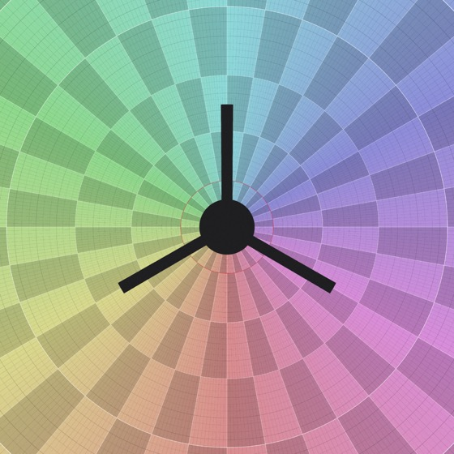
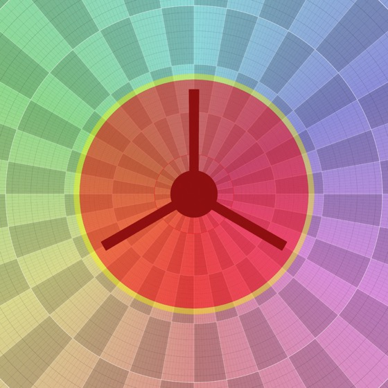
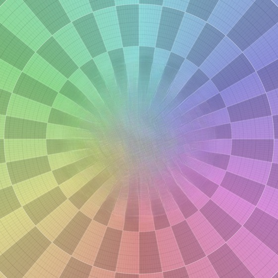
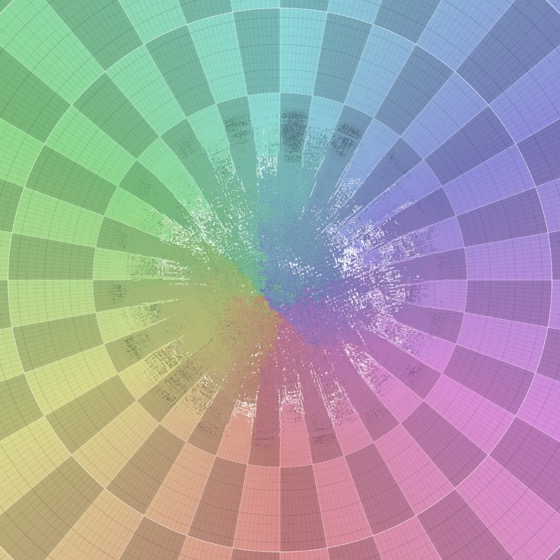
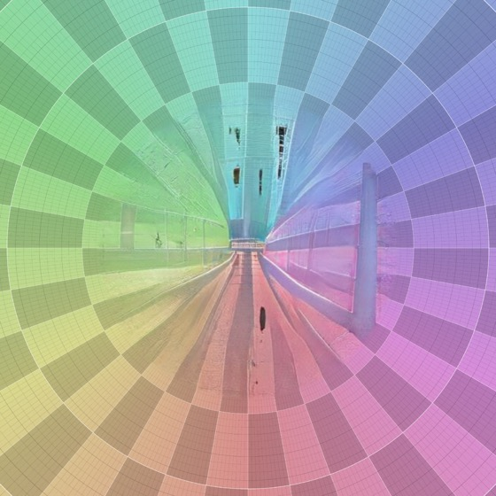
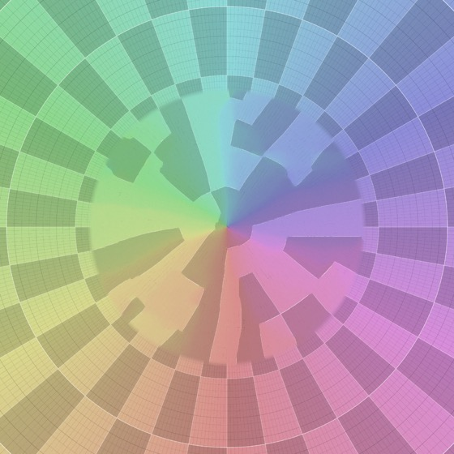

# Spike S3 – AI inpainting via ONNX: quality, speed, HDR, licences

- Issue: [#3](https://github.com/777555777/pano-retouch/issues/3)
- Code: branch `spike/s3-inpaint` (builds on S1/S2), `src-tauri/src/inpaint.rs`, `ai.rs`,
  `bin/s3-inpaint.rs` in
  [`spikes/s1-tile-viewer/`](https://github.com/777555777/pano-retouch/tree/spike/s3-inpaint/spikes/s1-tile-viewer) –
  throw-away, not merged into the product
- Date: 2026-10-26
- Status: **done – macOS and Windows measured, maintainer reviewed the real results**

## Question

Do LaMa / MI-GAN via `ort` (ONNX Runtime) with gnomonic reprojection give good nadir results on real
panoramas – also for HDR? How fast are they with CoreML/DirectML/CPU? Which licences allow them in an
AGPL-3.0 project with downloadable models? How does a classic fallback compare?

## Short answer

- **Default: PatchMatch + full-resolution texture pass, no model.** In the maintainer's review it looked
  best on the snow nadir – "maybe a little too perfect" (no stray grass blades), but clean and sharp. No
  download, no licence question, 4.5–6.5 s per region on both reference systems.
- **Optional: LaMa + texture pass** for cases where structure has to be continued (e.g. a shadow running
  into the cap on asphalt). Plain LaMa is visibly too soft at 300 MP (8× upscale); the texture pass makes
  it sharp, but in the review the copied texture looked **repetitive** ("patched over an area").
- **MI-GAN:** worst result in the review, but it visibly tries to integrate realistically – worth another
  look on other scene types (MIT licence, 56 ms on DirectML), not as a default.
- **Speed:** every method stays below the 10 s budget per nadir region – M4 Max 1.5–5 s, i7-12700K
  6.5–7.4 s – plus a one-off model load of 3 s (Mac) / 7–8 s (Windows) per session for LaMa.
- **GPU providers don't help LaMa:** CoreML is slower and needs 9 GB, DirectML fails at run time on
  LaMa's FFT block (automatic CPU fallback works). MI-GAN runs on DirectML (56 ms).
- **Licences:** LaMa Apache-2.0, MI-GAN MIT, both trained on Places2/Places365 (non-commercial image
  terms, effect on weights unsettled) → models only as an optional download with a notice (ADR-0004).
- The original stays **bit-exact outside the blend region** (checked on every run).

## How it works

```
level 0 ──render──► gnomonic view around the cap (level-0 density, ≤ 4096 px)
                      │ mask: cap (degrees) ∪ PTGui alpha hole, + feather band
                      │ HDR: exposure from the context median, Reinhard + gamma (exactly invertible)
                      ▼
         model input 512 px ──► LaMa / MI-GAN / PatchMatch ──► upscale to the view
                      │
                      ▼  "+tex": PatchMatch at full view resolution – match low frequencies
                      │          (blurred surroundings ↔ upscaled fill), copy full-detail pixels
                      ▼
         composite with the feathered weight ──reproject──► level 0, only where weight > 0
```

The model runs through `ort` 2.0.0-rc.15 (ONNX Runtime 1.31; prebuilt binaries with the CoreML EP on
macOS and the DirectML EP on Windows). Note: `ort` registers CoreML on macOS by default even if nothing
is requested (device policy "MaxEfficiency") – the CPU path must opt out explicitly.

## Test cases

Real images stay local (`testdata-local/_s3/`, maintainer review); the public pictures below use the
synthetic panorama.

| Case | Image | Mask | Challenge |
| --- | --- | --- | --- |
| A | 283 MP 16-bit TIFF (snow, Nodal Ninja tripod, hexagonal PTGui hole) | cap 23° + alpha | footprints around the tripod |
| A-HDR | the same scene as half-float EXR | cap 23° + alpha | tone mapping, colour cast |
| B | 84 MP 16-bit TIFF (asphalt, tripod, star-shaped hole, long shadow entering the cap) | cap 25° + alpha | fine grain at 1:1 |
| C | 71 MP Insta360 X5 JPEG (snow, nadir already blurred by the camera) | cap 15° | uniform texture |
| S | synthetic 288 MP panorama with a tripod | cap 27° | worst case: strict radial structure |

A and B also exist as JPEGs retouched by the maintainer in Photoshop (`… edited.jpg`) – a reference for
the review.

## Results

### Quality

**Maintainer review (case A, snow, local files):** MI-GAN worst, but it "tries to integrate very
realistically – could be interesting depending on the scene"; LaMa visibly soft; LaMa + texture sharper
and better, but "rather repetitive – you notice it was patched over an area"; **PatchMatch looks best**,
"maybe a little too perfect, because here and there a blade of grass sticks out beyond the footprints";
the difference between PatchMatch with and without texture is hard to see on white snow.

My own assessment of all cases:

| Method | A snow (+ A-HDR) | B asphalt | C snow | S synthetic |
| --- | --- | --- | --- | --- |
| LaMa (512 → upscale) | plausible trampled snow continuing the footprints | structure good (continues the shadow), **soft disc at 1:1** | seamless | continues the rays, soft |
| **LaMa + texture** | like LaMa, with grain; HDR: no seam, no colour cast | **real asphalt grain at 1:1**, structure kept | seamless | grid lines scattered as "texture" |
| MI-GAN | dark grass-like artefacts | fake shadow, white blob | mostly fine, invents a twig and a line | hallucinated corridors |
| PatchMatch + texture (no model) | clean but structureless disc | clean, sharp, structureless | faint lighter patch | blocky wedges |

| | before | mask (red = hole, yellow = feather) |
| --- | --- | --- |
| synthetic |  |  |

| LaMa | LaMa + texture | MI-GAN | PatchMatch + texture |
| --- | --- | --- | --- |
|  |  |  |  |

The synthetic panorama is deliberately hard (no stationary texture, strict geometry) – none of the methods
reconstructs a grid; on real ground the ranking above holds.

### Speed (MacBook Pro M4 Max, CPU execution provider)

| Step | A (view 4096²) | B (3233²) | C (1687²) |
| --- | --- | --- | --- |
| render view + mask | 0.4 s | 0.25 s | 0.2 s |
| LaMa inference (512²) | 1.1 s | 1.1 s | 1.1 s |
| texture refinement (full view) | 2.8 s | 1.6 s | 0.3 s |
| reproject into level 0 | 0.3 s | 0.1 s | 0.04 s |
| **LaMa + texture, total incl. 3 s model load** | **10.0 s** | 8.4 s | 5.9 s |
| MI-GAN inference (2048²) | 0.15 s | 0.15 s | 0.14 s |
| PatchMatch (1536²) + texture | 3.3 s | 2.0 s | 0.7 s |

Model loading (3 s) happens once per session; the per-region time for LaMa + texture is 1.5–5 s.
(Texture pass after an optimisation – search at half resolution, copy 2×2 blocks: A 0.8 s, B 0.34 s.)

Windows (i7-12700K, RTX 5080, case A, after the optimisation):

| Step | CPU | DirectML |
| --- | --- | --- |
| LaMa load / inference | 7.2–7.9 s / 1.6 s | runtime error in `…/ffc/convg2g/fu/rttn/MatMul_5` → CPU fallback |
| MI-GAN inference (2048²) | 1.38 s | **0.056 s** (first run 1.6 s) |
| texture pass (4096² view) | 3.5–3.8 s | – (CPU) |
| PatchMatch (1536²) | 1.0 s | – |
| reproject | 0.85–0.93 s | |
| **per region: LaMa + texture / PatchMatch + texture** | **~7.4 s / ~6.5 s** (+ one-off model load) | |
| peak RAM (whole run, 16-bit 283 MP) | 6.3 GB | 6.3 GB |

| Execution provider (M4 Max) | LaMa load / inference / peak RAM | MI-GAN load / inference |
| --- | --- | --- |
| **CPU** | 2.9 s / 1.1 s / +1 GB | 0.06 s / 0.16 s |
| CoreML (MLProgram fails → NeuralNetwork) | 8–14 s / 1.5 s / **9 GB** | 0.7 s / 0.34 s / 7 GB |

### HDR (EXR)

Tone mapping: exposure so that the median luminance of the known context becomes 0.18, then
Reinhard + 1/2.2 gamma; the result is mapped back exactly and written as half float. Mean colour of the
fill relative to the surrounding ring, in linear light: LaMa(+texture) 1.04 / 1.05 / 1.04 (RGB),
MI-GAN 0.98 / 1.03 / 1.00, PatchMatch 1.08 / 1.06 / 1.05 – no clipping, no visible colour cast, the fill
is at most a few percent brighter. 16-bit TIFFs go through 8 bit for the model; the texture pass copies
original 16-bit-derived pixels, so the grain keeps its tonal range.

### Sizes and memory

| | LaMa (`lama_fp32.onnx`) | MI-GAN (`migan_pipeline_v2.onnx`) |
| --- | --- | --- |
| Download | 208 MB | 28 MB |
| RAM during inference (CPU) | ~1 GB | ~1.6 GB (2048² input) |
| Native resolution | fixed 512×512 | arbitrary input, internally cropped and resized to 512 |
| ONNX Runtime in the app | +27 MB binary (macOS, static); Windows download incl. DirectML 361 MB | |

Whole run on a 283 MP 16-bit image: peak 9.1 GB – dominated by the spike keeping two copies of the full
image for the bit-exact check; the product edits tiles.

## Licences

| Model | Code | Weights | Training data | Verdict |
| --- | --- | --- | --- | --- |
| LaMa / Big-LaMa ([advimman/lama](https://github.com/advimman/lama), ONNX export [Carve/LaMa-ONNX](https://huggingface.co/Carve/LaMa-ONNX)) | Apache-2.0 | Apache-2.0 (repository licence; no separate weights licence) | Places2 / Places365 (non-commercial image terms) | offer as optional download with notice |
| MI-GAN ([Picsart-AI-Research/MI-GAN](https://github.com/Picsart-AI-Research/MI-GAN), [andraniksargsyan/migan](https://huggingface.co/andraniksargsyan/migan)) | MIT | MIT (`LICENSE-WEIGHTS`) | Places2 | licence fine, quality not |

AGPL-3.0 and Apache-2.0/MIT are compatible. The open question is the training data: Places365's
download terms restrict the *images* to non-commercial research; whether models trained on them inherit
that is legally unsettled. Because the app does not bundle the models, users decide to download them
(with this notice), and the app stays fully usable without them (PatchMatch fallback).

## Things learned

1. **512-px models need a full-resolution detail pass** at 300 MP – without it every fill is a soft disc.
   Matching low frequencies but copying original pixels gives real grain in the right structure.
2. **`ort` enables CoreML by default on macOS**; for these models the CPU is faster and uses far less
   memory. On Windows DirectML still has to be measured.
3. **ONNX Runtime on macOS needs clang's runtime** (`___isPlatformVersionAtLeast`) – link
   `clang_rt.osx` in `build.rs`.
4. **Masks:** a cap plus the PTGui alpha hole covers the tripod cases; long shadows reaching out of the
   cap need a painted mask (S2 brushes) – the pipeline itself accepts any mask.

## Not covered / open

- Maintainer review of cases B (asphalt) and C (Insta360) – the review covered case A.
- LaMa on the Windows GPU: CUDA instead of DirectML would need a multi-GB CUDA/cuDNN install; not worth it
  while the CPU stays within budget.
- Diversity in the texture pass (repetition), see recommendation.
- Larger LaMa resolutions (the ONNX export is fixed at 512; re-exporting with dynamic shapes would need
  PyTorch and the original checkpoint) – the texture pass makes this less pressing.
- Diffusion models (ADR-0004: later).
- Masks other than cap/alpha; edge cases such as the zenith or masks crossing the view border.

## Recommendation (→ ADR-0004)

- **Built-in default: PatchMatch + texture pass** (no model). Works on every platform at the same speed.
- **Optional AI model: LaMa** (208 MB download), always with the texture pass, for structure that has to
  continue. Run it on the **CPU** (CoreML slower, DirectML fails).
- Product work: make the texture pass less repetitive (penalise reusing the same source region, mix
  several candidates), optionally keep a little "noise" of the surroundings (stray grass) so fills look
  less clean.
- MI-GAN: not now; re-evaluate on other scene types (asphalt with lines, grass, gravel) later.
- Model download dialog with size and the training-data notice.

## How to reproduce

```bash
cd spikes/s1-tile-viewer/src-tauri
cargo run --release --features ai --bin s3-inpaint -- synthetic:24000 --cap 27 --methods lama,lama+tex,migan,pm+tex --provider cpu
```

Models are expected in `testdata-local/_models/` (`lama_fp32.onnx`, `migan_pipeline_v2.onnx`); results
are written to `testdata-local/_s3/<image>/` (`*-view.jpg` overview, `*-full.jpg` full resolution,
`*-reprojected.jpg` read back from the panorama, `report.json`).
